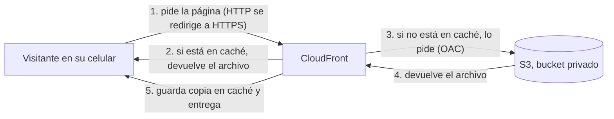
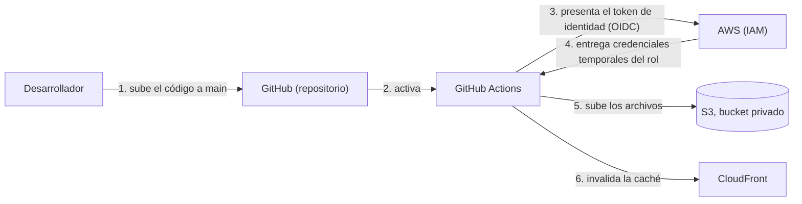

# panaderia-lupe-sitio
Sitio estatico de panaderia lupe en AWS
## El cliente y su necesidad

El cliente es una panadería local que necesitaba un sitio web estático: página de inicio con fotos, menú con precios, dirección, horario y botón de WhatsApp. Tenía un presupuesto muy limitado (quería pagar idealmente $0), con un aproximado de 100 a 300 visitas al mes y una actualización máxima de una vez al mes. No necesitaba compras en línea, registro de usuarios ni base de datos, y no quería tener que mantener servidores.

## Resultado

Quedó una página funcional que muestra el menú, los precios, la ubicación, el horario y un botón de WhatsApp. Cuando hay que cambiar algo, el desarrollador sube el cambio a GitHub y se refleja automáticamente en la página. A fecha de 26 de octubre de 2026, el costo ha sido de $0 USD usando el plan gratuito con créditos de AWS. Cuando se acaban los créditos o pasan los 6 meses del plan, lo que ocurra primero, AWS cierra la cuenta y el sitio deja de estar en línea. AWS conserva el contenido 90 días, y si se cambia a un plan de pago en ese plazo, la cuenta se reabre. Por eso el enlace en vivo puede dejar de funcionar; el código, los diagramas y la documentación permanecen en este repositorio.

## Por qué estos servicios

### S3 como almacén del sitio

Elegí S3 porque el sitio es estático: solo hay que entregar archivos, sin ejecutar código, y S3 lo hace sin servidores que administrar. Encaja con el presupuesto ideal de $0 del cliente y con sus visitas bajas, de 100 a 300 al mes. La alternativa era EC2, pero la descarté porque habría que mantener un servidor (sistema operativo, actualizaciones, que no se caiga), algo que el cliente no quería, y además cobra por las horas que está encendido.

## Arquitectura

### Flujo del visitante

### Flujo del despliegue

