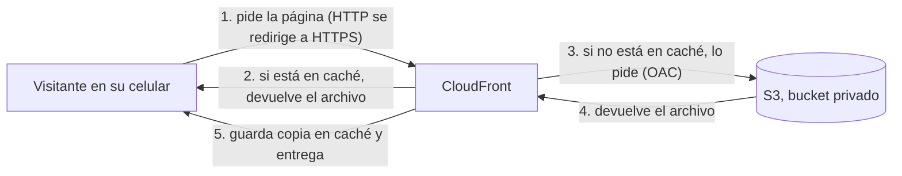
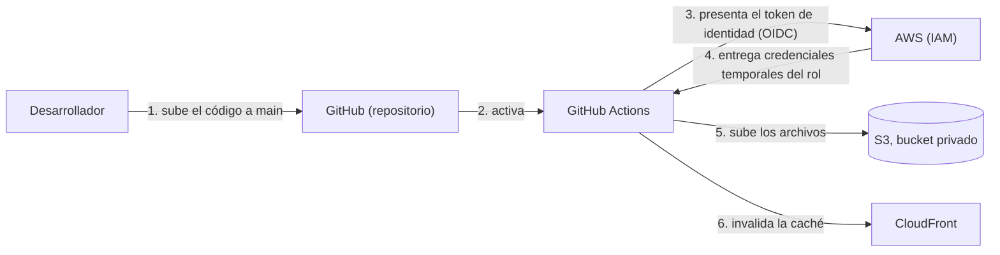

# panaderia-lupe-sitio
Sitio estatico de panaderia lupe en AWS
## El cliente y su necesidad

El cliente es una panadería local que necesitaba un sitio web estático: página de inicio con fotos, menú con precios, dirección, horario y botón de WhatsApp. Tenía un presupuesto muy limitado (quería pagar idealmente $0), con un aproximado de 100 a 300 visitas al mes y una actualización máxima de una vez al mes. No necesitaba compras en línea, registro de usuarios ni base de datos, y no quería tener que mantener servidores.

## Resultado

Quedó una página funcional que muestra el menú, los precios, la ubicación, el horario y un botón de WhatsApp. Cuando hay que cambiar algo, el desarrollador sube el cambio a GitHub y se refleja automáticamente en la página. A fecha de 26 de octubre de 2026, el costo ha sido de $0 USD usando el plan gratuito con créditos de AWS. Cuando se acaban los créditos o pasan los 6 meses del plan, lo que ocurra primero, AWS cierra la cuenta y el sitio deja de estar en línea. AWS conserva el contenido 90 días, y si se cambia a un plan de pago en ese plazo, la cuenta se reabre. Por eso el enlace en vivo puede dejar de funcionar; el código, los diagramas y la documentación permanecen en este repositorio.

## Por qué estos servicios

### S3 como almacén del sitio

Elegí S3 porque el sitio es estático: solo hay que entregar archivos, sin ejecutar código, y S3 lo hace sin servidores que administrar. Encaja con el presupuesto ideal de $0 del cliente y con sus visitas bajas, de 100 a 300 al mes. La alternativa era EC2, pero la descarté porque habría que mantener un servidor (sistema operativo, actualizaciones, que no se caiga), algo que el cliente no quería, y además cobra por las horas que está encendido.

### CloudFront con OAC

Elegí CloudFront con OAC porque mantiene el bucket de S3 privado: solo CloudFront puede leerlo, y lo comprobé al abrir la dirección directa de S3, que respondió AccessDenied. Además entrega el sitio con HTTPS, redirige automáticamente el tráfico HTTP a HTTPS y su caché hace que la página cargue rápido para los visitantes. La alternativa era dejar el bucket público, pero la descarté porque quedaría expuesto directamente a cualquiera y porque la dirección pública de un sitio de S3 solo funciona con HTTP, sin candado.

### GitHub Actions con OIDC

Elegí GitHub Actions con OIDC porque GitHub asume un rol de IAM y recibe credenciales temporales, sin que yo guarde llaves de acceso de larga duración en ningún lado. Además, el rol solo puede asumirse desde mi repositorio y mi rama main, y cuando una configuración falló pude ver en CloudTrail exactamente qué identidad había presentado GitHub. La alternativa era guardar llaves de acceso como secreto en GitHub, pero la descarté porque, si alguien las encuentra, puede entrar a mi cuenta de AWS hasta que se desactiven. También automatizar el despliegue evita subir los archivos a mano desde la consola cada vez que cambia el menú, algo que ocurre una vez al mes y que prefiero no depender de pasos manuales.

Servicios descartados
WAF

Descarté WAF. Es un servicio que protege sitios y aplicaciones filtrando tráfico malicioso, por ejemplo bloqueando direcciones IP o limitando el número de peticiones. No lo usé porque cobra una cuota fija mensual aunque nadie visite el sitio, y el cliente quería que el costo fuera idealmente $0. En su lugar configuré una alerta de presupuesto con AWS Budgets para enterarme si aparece cualquier cargo. Lo usaría en un sitio con muchas visitas o con formularios, inicio de sesión o compras, donde el riesgo de abuso sí justifica la cuota.

Route 53

Descarté Route 53. Es el servicio de DNS de AWS: traduce un nombre de dominio, como el de la panadería, a la dirección IP donde está el sitio. No lo usé porque implica un dominio propio, y el cliente quería que el costo fuera idealmente $0: el dominio se paga una vez al año y Route 53 cobra por la zona y por las consultas. En su lugar, el sitio usa la dirección que CloudFront genera automáticamente, que ya tiene HTTPS porque AWS tiene el certificado de ese dominio. Lo usaría si el cliente quisiera una dirección propia y fácil de recordar; en ese caso también necesitaría un certificado de ACM, solicitado en la región us-east-1 para poder usarlo con CloudFront.

Seguridad

El rol que usa GitHub Actions tiene una política con solo tres acciones, cada una limitada a su propio recurso: ListBucket sobre el bucket, para ver qué archivos ya existen; PutObject sobre los archivos del bucket, para subir los nuevos; y CreateInvalidation sobre mi distribución de CloudFront, para renovar la caché. No incluye permisos para leer ni borrar archivos, ni para usar ningún otro servicio, siguiendo el principio de mínimo privilegio. Además, el rol solo puede asumirse desde mi repositorio y mi rama main.

Política de permisos del rol (con marcadores en lugar de mis datos reales):

{
  "Version": "2012-10-17",
  "Statement": [
    {
      "Sid": "ListarBucket",
      "Effect": "Allow",
      "Action": "s3:ListBucket",
      "Resource": "arn:aws:s3:::<nombre-del-bucket>"
    },
    {
      "Sid": "SubirArchivos",
      "Effect": "Allow",
      "Action": "s3:PutObject",
      "Resource": "arn:aws:s3:::<nombre-del-bucket>/*"
    },
    {
      "Sid": "InvalidarCache",
      "Effect": "Allow",
      "Action": "cloudfront:CreateInvalidation",
      "Resource": "arn:aws:cloudfront::<ID-cuenta>:distribution/<ID-distribución>"
    }
  ]
}

## Problemas que resolví

### El rol rechazaba a GitHub aunque todo parecía correcto

El workflow de GitHub Actions fallaba en el paso de credenciales con el error "Could not assume role with OIDC: Not authorized to perform sts:AssumeRoleWithWebIdentity". Fui descartando causas desde GitHub: la política de confianza del rol, que el valor de sub coincidiera con mi repositorio, las mayúsculas, que el workflow corriera en la rama main y el ARN guardado en la variable del repositorio. Todo coincidía, así que busqué en el historial de eventos de CloudTrail, que mostró el valor de sub que GitHub había enviado de verdad: incluía identificadores numéricos del usuario y del repositorio que mi política no tenía. Como la condición exige que coincida el texto completo, AWS rechazaba la petición. Lo resolví reemplazando el valor de la condición por el que aparecía en CloudTrail, y de paso la política quedó más segura, porque ata el rol a ese repositorio en concreto: si alguien borrara el repositorio y creara otro con el mismo nombre, tendría un identificador distinto y no podría asumir el rol. Aprendí que cuando un rol rechaza una identidad y todo parece correcto, lo primero es mirar en CloudTrail qué envió realmente el otro lado, en lugar de adivinar el formato.

## Arquitectura

### Flujo del visitante

### Flujo del despliegue

